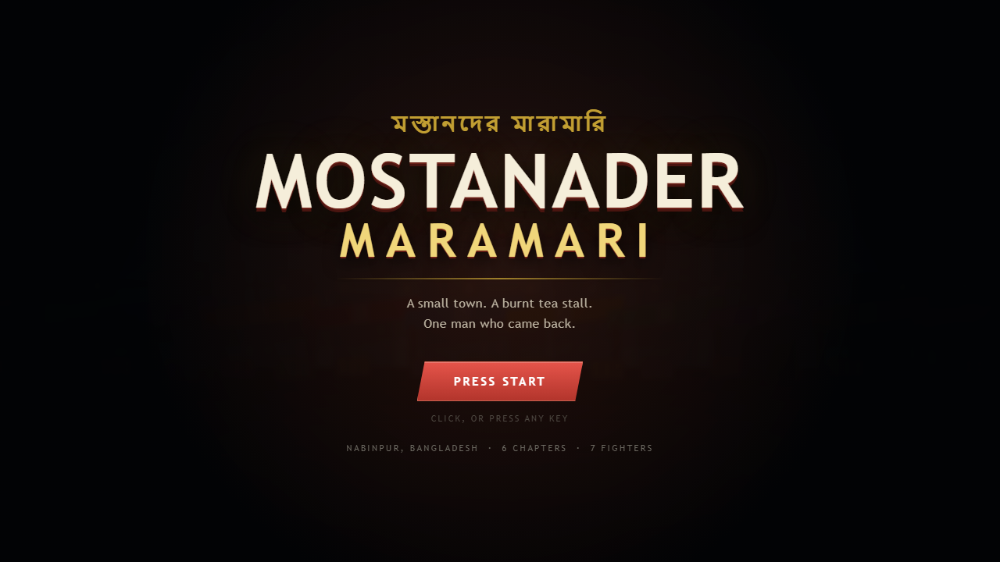
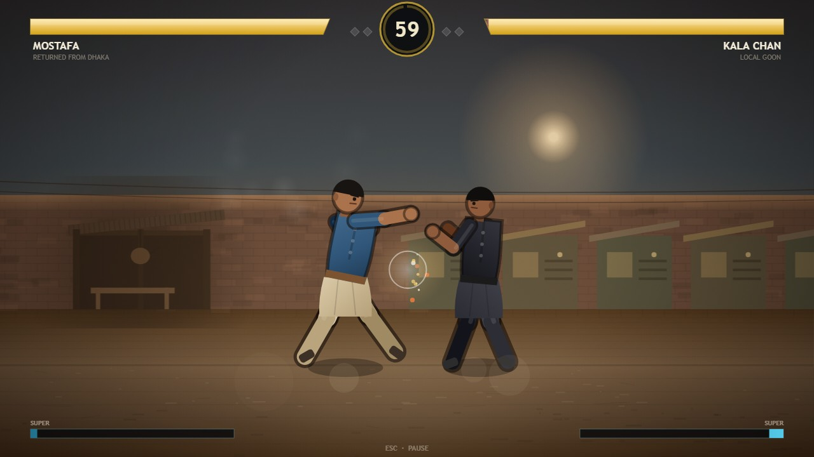
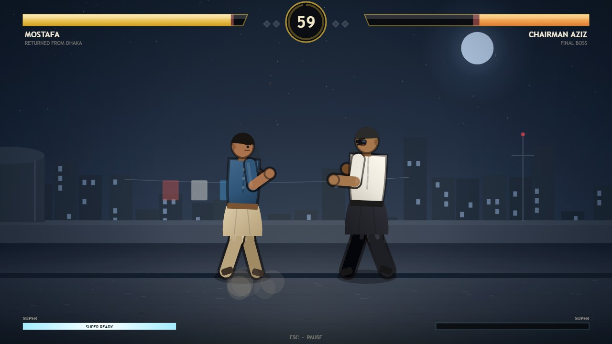
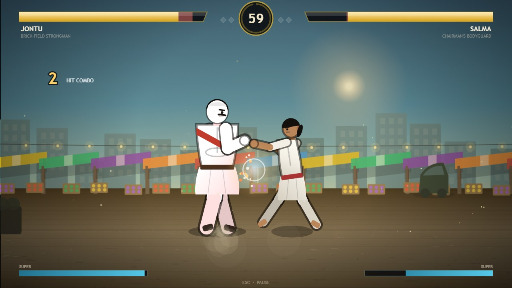
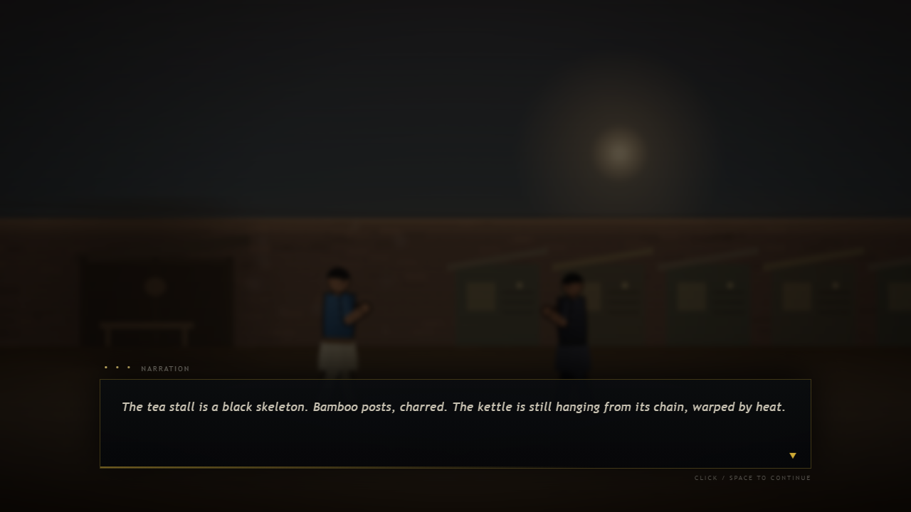
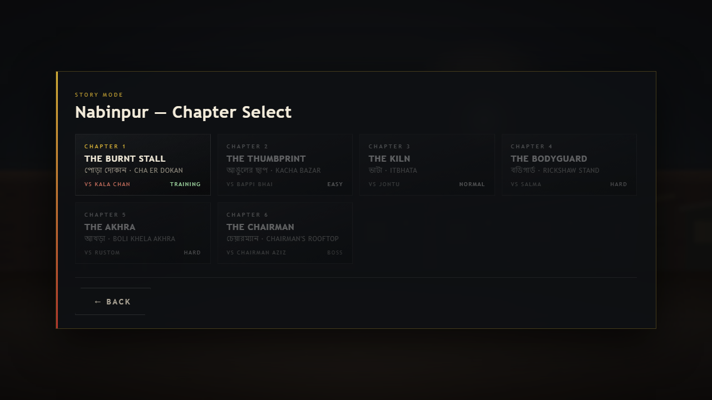
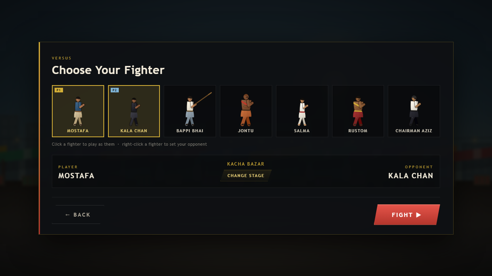
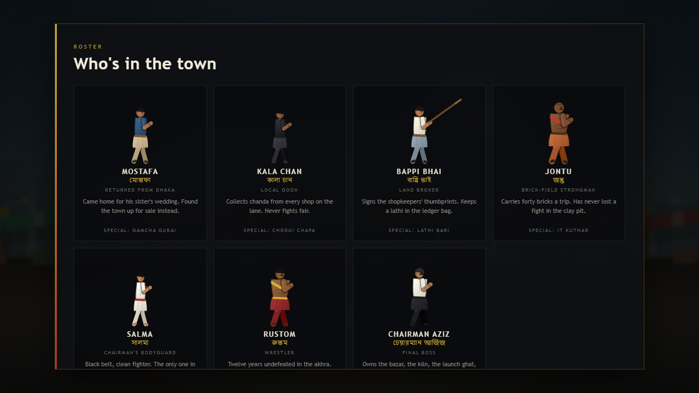
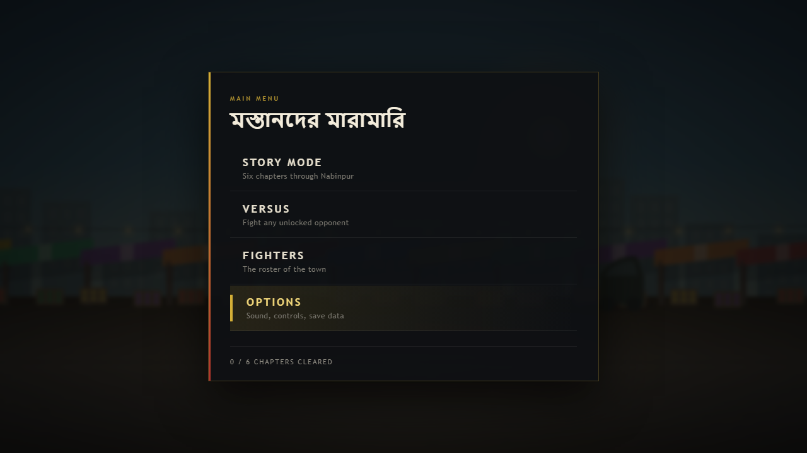
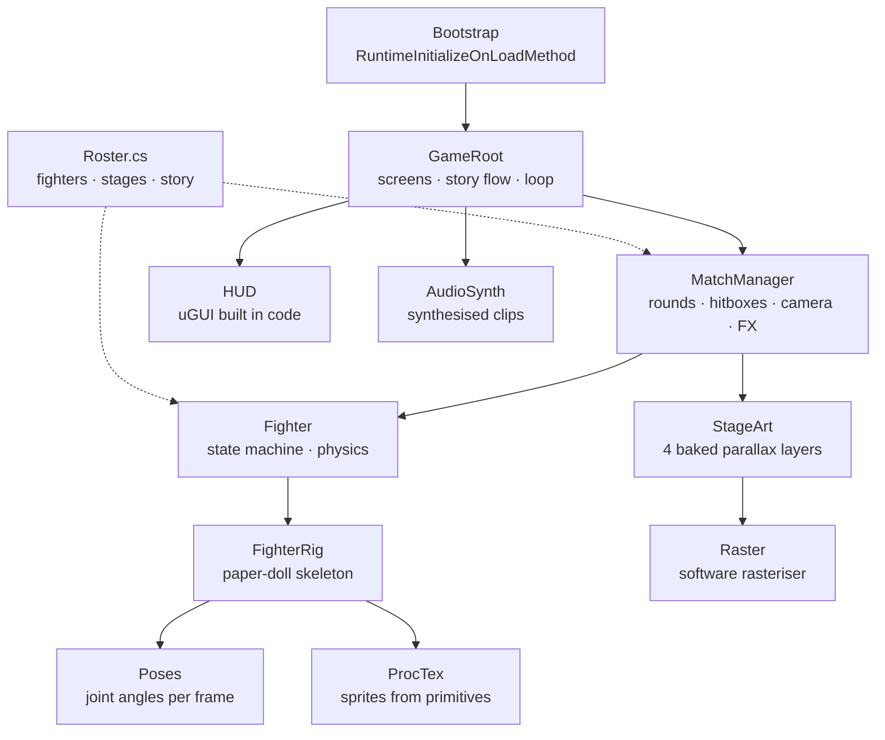

<div align="center">

# মস্তানদের মারামারি
# MOSTANADER MARAMARI

**A story-driven 2D fighting game set in Nabinpur, a small town in Bangladesh.**

Six chapters · Seven fighters · Six stages · Zero imported assets

[](https://mostanader-maramari.vercel.app)


</div>



---

## The pitch

Mostafa comes home from Dhaka for his sister's wedding. He finds his father's tea stall
burnt to a black skeleton, the bazar being bought out one thumbprint at a time, and a
Chairman who owns the kiln, the launch ghat and half the police station.

So he does the only thing left. **He starts walking down the lane.**

You fight through six chapters of a Bangladeshi small town — the tea stall at dawn, the
vegetable market at noon, the brick kiln, a rainy rickshaw stand, a boli khela wrestling
pit, and finally a rooftop above the whole town.

---

## Contents

| | |
|---|---|
| [Screenshots](#screenshots) | What it actually looks like |
| [Features](#features) | What's in the box |
| [The town](#the-town) | Six stages |
| [The roster](#the-roster) | Seven fighters |
| [The story](#the-story) | Six chapters |
| [Controls](#controls) | Keyboard layout |
| [Combat system](#combat-system) | Frame data, blocking, hitstop |
| [How it's made](#how-its-made) | Architecture, and why there are no assets |
| [Run it](#run-it) | Browser, Unity, or deploy your own |
| [Project structure](#project-structure) | Where everything lives |
| [Known limits](#known-limits) | Honest status |

---

## Screenshots

| | |
|:---:|:---:|
|  |  |
| **Cha er Dokan** — the burnt stall, chapter 1 | **The rooftop** — Mostafa vs. Chairman Aziz |
|  |  |
| **Kacha Bazar** — Jontu vs. Salma | Story scenes play over the live stage |
|  |  |
| **Chapter select** — progress is saved | **Versus** — pick any fighter |
|  |  |
| **Roster** — every fighter has a bio | **Main menu** |

---

## Features

**Combat**

- Frame-accurate state machine — startup / active / recovery, measured in 60ths of a second
- **Hitstop** freeze frames, screen shake and slow-motion KOs
- Three attack heights: `high` / `mid` / `low`, each with its own blocking rules
- Guard-walk — hold away and you retreat *with your guard up*
- Combo system with damage scaling and an on-screen counter
- 50-meter **special** and 100-meter **super** per fighter, each unique
- Best-of-three rounds with a 60-second clock

**Opponents**

- Distance-band AI that reacts on a delay instead of reading your inputs
- Per-chapter difficulty: reaction time, aggression, block rate, anti-air rate
- It blocks, punishes whiffs, jumps in, and uses its super

**Presentation**

- Every fighter is a **paper-doll skeleton** driven by joint angles — no sprite sheets
- Every stage is **baked at load time** by a software rasteriser into four parallax layers
- Every sound is **synthesised sample-by-sample** — punches, blocks, bells and a
  three-track folk loop in a Bhairavi-flavoured scale
- Weather per stage: rising steam, flies, kiln dust, rain, embers, city lights

---

## The town

| # | Stage | Place | Weather | Mood |
|---|---|---|---|---|
| 1 | **Cha er Dokan** | tea stall at dawn | steam | charred bamboo, kettle on its chain, warm shop windows |
| 2 | **Kacha Bazar** | vegetable market, midday | flies | striped tarpaulin roofs, produce crates, a CNG auto-rickshaw |
| 3 | **Itbhata** | brick kiln | dust | chimneys, brick stacks, kiln fire glowing orange |
| 4 | **Rickshaw Stand** | rainy night | rain | neon medicine shop, wet asphalt, three parked rickshaws |
| 5 | **Boli Khela Akhra** | wrestling pit, festival | embers | crowd of four thousand, bunting, drums, torches |
| 6 | **Chairman's Rooftop** | night, above the town | city lights | water tank, laundry line, antenna, the whole town below |

---

## The roster

| Fighter | Role | Style | Special (50) | Super (100) |
|---|---|---|---|---|
| **MOSTAFA** | Returned from Dhaka | balanced | Gamcha Gurai — spinning 3-hit rush | Nabinpur Bidroho |
| **KALA CHAN** | Local goon | fast, light | Chorui Chapa — dashing knife-hand | Goli Rash |
| **BAPPI BHAI** | Land broker | long reach (lathi) | Lathi Bari — overhead stick sweep | Dolil Bondho |
| **JONTU** | Brick-field strongman | heavy, slow, armoured | It Kuthar — brick hammer slam | Bhatar Agun |
| **SALMA** | Chairman's bodyguard | fastest | Dui Lathi Kick — double straight kick | Shottho Karate |
| **RUSTOM** | Boli khela champion | grappler, armoured | Boli Dhap — charging tackle | Akhrar Badshah |
| **CHAIRMAN AZIZ** | Final boss | dirty boxer | Chairman Order — calls his guards | Shob Tomar |

---

## The story

| Ch | Title | Stage | Opponent | Difficulty |
|---|---|---|---|---|
| 1 | The Burnt Stall | Cha er Dokan | Kala Chan | `TRAINING` |
| 2 | The Thumbprint | Kacha Bazar | Bappi Bhai | `EASY` |
| 3 | The Kiln | Itbhata | Jontu | `NORMAL` |
| 4 | The Bodyguard | Rickshaw Stand | Salma | `HARD` |
| 5 | The Akhra | Boli Khela Akhra | Rustom | `HARD` |
| 6 | The Chairman | Chairman's Rooftop | Chairman Aziz | `BOSS` |

Each chapter opens and closes with a dialogue scene played over the live stage.
Clearing a chapter saves progress and unlocks the next one.

---

## Controls

| Action | Key | | Action | Key |
|---|---|---|---|---|
| Walk | `A` / `D` | | Jab | `J` |
| Jump | `W` | | Heavy punch | `K` |
| Crouch | `S` | | Kick | `L` |
| Stand block | hold **away** | | Low kick | `S` + `L` |
| Crouch block | `S` + **away** | | Special (50 meter) | `U` |
| Pause | `Esc` | | Super (100 meter) | `I` |

> Holding away retreats **and** keeps your guard up. You are never stuck in place.

---

## Combat system

### Frame data

| Move | Startup | Active | Recovery | Damage | Height | Chip on block |
|---|---:|---:|---:|---:|:---:|---:|
| Jab | 4f | 3f | 7f | 4.0 | mid | 10% |
| Heavy punch | 9f | 4f | 17f | 9.0 | mid | 14% |
| Kick | 7f | 4f | 14f | 7.0 | high | 12% |
| Low kick | 5f | 3f | 11f | 5.0 | low | 10% |
| Jump attack | 4f | 8f | 4f | 8.0 | high | 14% |

All values are at 60 fps. A fighter may cancel out of a move into another one **only after
it has connected**, which is what makes combos possible but not free.

### The blocking triangle

```
   high attack   →  beats crouch-block
   low attack    →  beats stand-block
   jump-in       →  beats crouch-block
   crouch-block  →  stops mids and lows
   stand-block   →  stops mids and highs
```

Every attack also carries its own `hitstop` (4–12 frames), `hitstun`, `blockstun`,
knockback and meter gain. Heavier fighters hit harder and are harder to move.

---

## How it's made

There are **no image files, no audio files, no sprite sheets and no animation clips**
anywhere in this repository. Everything you see and hear is generated at runtime.



### Three ideas hold it together

**1 · `ProcTex` — a rasteriser in 200 lines**
`Rect`, `Disc`, `Line`, `Curve`, `VGradStops`, `SoftGlow`, alpha compositing. Stage art is
drawn into a `Color32` buffer at load time and uploaded as one texture per layer, so the
six backdrops cost nothing per frame.

**2 · `FighterRig` — a skeleton, not a sprite**
Each fighter is ~40 primitive sprites parented into joints: torso, head, two-segment arms,
two-segment legs, a gamcha that sways with velocity. `Poses.cs` returns joint angles as a
function of progress through a move, so every animation is a few lines of maths.

**3 · `AudioSynth` — sound from arithmetic**
Envelopes over filtered noise for hits and whooshes; additive synthesis for the bell; a
16-step sequencer rendering a droning folk loop in a Bhairavi-flavoured scale, baked to an
`AudioClip` at startup.

---

## Project structure

```
mostander-maramari/
├─ README.md
├─ GAME-DESIGN.md              full design document
├─ vercel.json                 static deploy config (outputs WebBuild/)
├─ docs/screens/               screenshots used above
│
├─ MostanaderMaramari/         Unity project (2021.3+)
│  ├─ Assets/Scenes/Main.unity
│  ├─ Assets/Scripts/Core/     Bootstrap · GameRoot · AudioSynth · InputMap
│  ├─ Assets/Scripts/Fight/    Roster · Fighter · MatchManager · AIBrain
│  ├─ Assets/Scripts/Art/      ProcTex · StageArt · FighterRig · Poses
│  ├─ Assets/Scripts/UI/       UI · HUD
│  └─ Assets/Editor/           scene helpers
│
└─ WebBuild/                   playable browser build
   ├─ index.html
   ├─ css/style.css
   └─ js/  audio · data · art · combat · ai · story · game
```

---

## Run it

### Browser — no install

Open **`WebBuild/index.html`**. That's it: no build step, no server, no dependencies.

Or use the live deployment: **https://mostanader-maramari.vercel.app**

### Unity

1. Install **Unity 2021.3 LTS or newer** (2022.3 and Unity 6 also work)
2. **Unity Hub → Add → Add project from disk** → select `MostanaderMaramari/`
3. Open `Assets/Scenes/Main.unity` and press **Play**

The scene is deliberately empty — `Bootstrap.cs` builds the camera, the UI and the whole
game on `AfterSceneLoad`. There is nothing to wire up in the inspector.

If the scene is ever missing: **Mostanader Maramari → Create Fresh Main Scene**.

### Deploy your own

```bash
git clone https://github.com/Shafiur0/Mostanader-Maramari.git
cd Mostanader-Maramari
vercel deploy --prod
```

`vercel.json` points the output at `WebBuild/`, so no framework preset is needed.

---

## Known limits

- The **browser build** is tested end-to-end: story flow, chapter clear, versus, KO,
  save data, all menus.
- The **Unity project** is complete source that bootstraps itself at runtime. It has been
  reviewed and corrected but not yet run inside the editor on the machine it was written
  on (no Unity install there) — expect to shake out a compile detail on first open.
- The browser build is the reference implementation; the Unity build is a port of the same
  design and does not yet include the weather particle layer.
- Touch controls are not implemented. Keyboard only.

---

## Credits

Design, code, art and audio: **Shafiur Rahman** ([@Shafiur0](https://github.com/Shafiur0))

Built with Unity's built-in 2D pipeline and the HTML5 canvas. No third-party assets,
no runtime dependencies, no external services.

---

<div align="center">

*Cha khaben?* ☕

</div>
